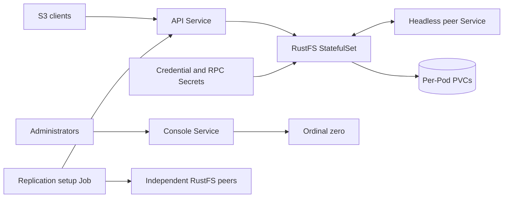

# RustFS

[RustFS](https://rustfs.com) is an S3-compatible object storage server written in Rust. The HelmForge chart deploys
the official `docker.io/rustfs/rustfs:1.0.3` image as a durable singleton or a distributed StatefulSet, with
Secret-backed credentials, explicit process listeners, optional Ingress resources, NetworkPolicy, and controlled
bucket or site replication setup.

The chart is alpha. Validate storage, placement, failure recovery, capacity, and replication behavior with the
specific Kubernetes distribution and storage driver used in production.

## What this chart provides

- standalone, distributed, and `cluster` alias topologies from one StatefulSet implementation;
- a retained PVC per storage member, or an existing claim for standalone deployments;
- independent S3 API and console process listeners and client-facing Service ports;
- generated or existing S3 credentials and a separate distributed RPC Secret;
- separate API and console Services and optional Ingress resources;
- default-deny ingress isolation with same-namespace access by default;
- optional PodDisruptionBudget and topology-aware scheduling controls;
- post-install and post-upgrade Jobs for bucket or whole-site replication setup;
- authenticated S3 object-write, read, comparison, and cleanup validation.

## Install a standalone server

Create credentials without placing the secret key in a values file or command-line argument:

```bash
kubectl create namespace rustfs
kubectl -n rustfs create secret generic rustfs-credentials \
  --from-literal=access-key='rustfsadmin' \
  --from-file=secret-key=/secure/path/rustfs-secret-key
```

Install the chart:

```bash
helm repo add helmforge https://repo.helmforge.dev
helm repo update
helm install storage helmforge/rustfs \
  --version 1.1.1 \
  --namespace rustfs \
  --set auth.existingSecret=rustfs-credentials
```

Keep the credential file outside the repository, restrict its permissions, and remove it securely after verifying the
Secret.

## Architecture and storage

`architecture: standalone` requires exactly one replica. It supports a generated PVC, an existing claim, or ephemeral
`emptyDir` storage for disposable evaluation. Ephemeral storage loses all objects when the Pod is removed.

`architecture: distributed` and `architecture: cluster` are equivalent. Both require at least four replicas and
persistent storage. Each ordinal owns a separate PVC, and a headless Service supplies stable peer DNS. The API listener
also carries internode RPC, so every member must reach every other member on `containerPorts.api`.



Do not change architecture, replica count, storage class, generated names, or distributed listener ports on an existing
installation without an upstream-supported migration plan. Helm retains generated data claims when the release is
removed.

## Configure credentials

For production and GitOps, use `auth.existingSecret`. It must contain `access-key` and `secret-key` by default; change
`auth.existingSecretAccessKeyKey` and `auth.existingSecretSecretKeyKey` when your Secret uses different entries.

Distributed deployments also need one stable RPC secret shared by every member. Set `auth.rpcExistingSecret` and
`auth.rpcSecretKey`, or allow Helm to create and reuse a generated value. Rotating either credential requires a planned
restart and, for replication relationships, any additional upstream migration steps.

Inline values are intended only for evaluation because Helm stores them in release history.

## Understand listeners and Services

The listener values configure the real RustFS processes:

| Purpose                  | Process value            | Service value         | Default |
| ------------------------ | ------------------------ | --------------------- | ------- |
| S3 API and internode RPC | `containerPorts.api`     | `service.port`        | `9000`  |
| Web console              | `containerPorts.console` | `consoleService.port` | `9001`  |

Service ports may differ from process ports because Services target the named `api` and `console` ports. Changing
`containerPorts.api` also changes `RUSTFS_ADDRESS`, the advertised default address, the headless peer Service, and
distributed peer URLs. Changing `containerPorts.console` changes `RUSTFS_CONSOLE_ADDRESS`.

The two process listeners must differ while the console is enabled. Set `config.externalAddress` when clients need an
advertised address other than the API listener-derived default.

For temporary local access:

```bash
kubectl -n rustfs port-forward service/storage-rustfs 9000:9000
kubectl -n rustfs port-forward service/storage-rustfs-console 9001:9001
```

## Restrict network access

NetworkPolicy is enabled by default. Empty `networkPolicy.apiIngressFrom` and
`networkPolicy.consoleIngressFrom` lists allow Pods in the release namespace and deny other namespaces. This keeps
distributed peers connected because internode RPC shares the API port.

Declare explicit Kubernetes NetworkPolicy peers before admitting callers or ingress controllers from other namespaces:

```yaml
networkPolicy:
  enabled: true
  apiIngressFrom:
    - namespaceSelector:
        matchLabels:
          kubernetes.io/metadata.name: applications
  consoleIngressFrom:
    - namespaceSelector:
        matchLabels:
          kubernetes.io/metadata.name: platform-admin
```

Disabling NetworkPolicy removes chart-managed isolation; it does not add authentication or transport encryption.

## Expose the API and console

The API and console use independent Ingress values. S3 must remain at the root path so request signing is preserved.
Terminate TLS at the ingress controller and use separate hostnames and certificates for the two surfaces. RustFS and S3
credentials, object payloads, and console sessions must not cross an untrusted network over plain HTTP.

Example API Ingress values:

```yaml
ingress:
  enabled: true
  ingressClassName: nginx
  hosts:
    - host: s3.example.com
      paths:
        - path: /
          pathType: Prefix
  tls:
    - secretName: rustfs-api-tls
      hosts:
        - s3.example.com
```

The chart does not create certificates, application-level TLS, Gateway API resources, or custom CA bundles.

## Configure replication

Replication connects independent RustFS deployments; it is not a substitute for distributed storage, backups, or
application failover. The chart uses a bounded post-install and post-upgrade hook Job with the pinned official CLI.

Bucket replication configures directional rules for listed buckets. Site replication links complete deployments and
must be owned by only one Helm release. Every endpoint must be mutually reachable and use certificates trusted by the
CLI and servers. Setup is applied during installation or upgrade; it is not continuously reconciled.

Removing replication values or uninstalling the chart does not remove remote rules or site relationships. Perform
those destructive operations explicitly with upstream administration tools. Start from the examples packaged in the
chart:

- `examples/replication-bucket/values.yaml` for bucket rules;
- `examples/replication-site/values.yaml` for whole-site relationships.

See the [RustFS CLI reference](https://github.com/rustfs/cli/tree/v0.1.36/docs/reference/rc) and
[site replication guide](https://github.com/rustfs/docs.rustfs.com/blob/main/content/en/operations/high-availability/site-replication.md).

## Production configuration reference

Use the [playground](/playground) and select RustFS to generate a non-secret starting values file.

| Value                                  | Default          | Purpose                                                    |
| -------------------------------------- | ---------------- | ---------------------------------------------------------- |
| `architecture`                         | `standalone`     | Storage topology                                           |
| `replicaCount`                         | `1`              | One standalone member or at least four distributed members |
| `image.repository` / `image.tag`       | RustFS / `1.0.3` | Official pinned application image                          |
| `auth.existingSecret`                  | `""`             | Existing S3 credential Secret                              |
| `auth.rpcExistingSecret`               | `""`             | Existing distributed RPC Secret                            |
| `config.consoleEnabled`                | `true`           | Enable the web console and its Service                     |
| `config.externalAddress`               | `""`             | Advertised API address; empty derives the API listener     |
| `containerPorts.api`                   | `9000`           | Real S3 API and internode RPC listener                     |
| `containerPorts.console`               | `9001`           | Real console listener                                      |
| `persistence.enabled`                  | `true`           | Create durable data claims                                 |
| `persistence.size`                     | `10Gi`           | Capacity requested per member                              |
| `service.port` / `consoleService.port` | `9000` / `9001`  | Client-facing Service ports                                |
| `networkPolicy.enabled`                | `true`           | Restrict API, RPC, and console ingress                     |
| `pdb.enabled`                          | `false`          | Limit voluntary disruptions                                |
| `resources`                            | `{}`             | Application requests and limits                            |
| `replication.enabled`                  | `false`          | Run bucket or site replication setup                       |

See the chart `values.yaml` and JSON schema for the complete contract, including image digests, CORS, probes,
scheduling, Ingress rules, labels, extra environment variables, and extra manifests.

## Health and operations

Startup and liveness use `/health`; readiness uses `/health/ready`. These endpoints prove process health, not durable
object storage. HelmForge runtime validation separately performs an authenticated S3 write, read, byte comparison, and
cleanup.

Start troubleshooting with workload state, storage binding, logs, and events:

```bash
kubectl -n rustfs get statefulset,pod,svc,pvc
kubectl -n rustfs logs statefulset/storage-rustfs --tail=200
kubectl -n rustfs get events --sort-by=.lastTimestamp
helm test storage -n rustfs --logs
```

For distributed startup failures, verify peer DNS, PVC ownership for UID/GID 10001, shared RPC credentials, and
connectivity on `containerPorts.api`. The distributed console selects ordinal zero and remains unavailable while that
Pod is down even if S3 traffic continues.

Monitor capacity, latency, error rates, member readiness, replication lag, setup Job outcomes, and tested restore
procedures. The chart does not install metrics backends, dashboards, alert rules, or backup software.

## Uninstall

```bash
helm uninstall storage --namespace rustfs
```

Generated PVCs and remote replication state are intentionally not deleted. Inventory and remove them only after data
retention and recovery requirements are satisfied.
